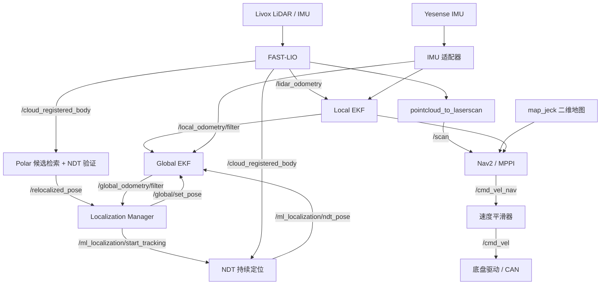

# FAST-LIO Localization & Nav2 Navigation

基于 **ROS 2 Humble** 的机器人定位与自主导航工作空间，集成 FAST-LIO 激光惯性里程计、Polar 全局重定位、NDT 持续定位、双 EKF 融合、Nav2 导航和底盘驱动。

仓库名：`Fast_LIO_Nav2_pc2ls_ws_1018_show_jq_Orin`。本仓库是从本地 ZIP 整理的个人私有源码快照，包含地图与关键帧数据，不包含组织仓库的 Git 提交历史。

> 当前快照的启动包装脚本引用了尚未随 ZIP 提供的 `localization_config/`。首次使用前请按下文补齐并核对配置。原项目文档仍记录地图对齐、安装标定与目标车辆验证等待验收事项；本次文档整理没有重新进行构建、回放或实车测试。

## 功能概览

| 能力 | 实现 |
| --- | --- |
| 激光惯性里程计 | Livox 点云与 IMU 输入 FAST-LIO，输出局部位姿与机体系点云 |
| 全局初始化 | Polar 描述子检索候选，NDT 验证，Manager 完成初始化交接 |
| 持续定位 | NDT 地图匹配、质量门控、滑动子图与定位状态输出 |
| 双 EKF 融合 | Local EKF 提供局部里程计；Global EKF 融合 NDT 与局部运动 |
| 自主导航 | 静态地图、点云转 LaserScan、全局规划、MPPI 局部控制及速度平滑 |
| 自定义控制代价 | `CruiseSpeedCritic` 在条件满足时对巡航速度提供有界轨迹代价偏好 |
| 硬件集成 | Livox MID360 系列驱动、Yesense IMU、SocketCAN 底盘接口 |
| 运维检查 | 定位初始化状态、输入检查脚本、TF 检查与分模块日志 |

## 目录

- [系统架构](#系统架构)
- [目录与软件包](#目录与软件包)
- [环境与依赖](#环境与依赖)
- [下载与构建](#下载与构建)
- [首次部署配置](#首次部署配置)
- [实机启动流程](#实机启动流程)
- [录包回放定位](#录包回放定位)
- [接口与坐标系](#接口与坐标系)
- [参数与调优入口](#参数与调优入口)
- [检查与故障排查](#检查与故障排查)
- [已知限制与验证范围](#已知限制与验证范围)
- [原始文档与来源](#原始文档与来源)

## 系统架构



定位初始化交接：

```text
Polar 重定位结果
  → Manager 校验时间、坐标系、四元数、协方差及局部位姿同步
  → 调用 /global/set_pose
  → 确认两条不同时间的 Global EKF 输出
  → 调用 /ml_localization/start_tracking
  → 等待放行之后的新扫描进入 TRACKING
  → manager_state 中 startup_complete=1
```

Manager 负责初始化交接和状态监控，不执行点云配准，也不发布定位 TF。当前采用启动时初始化模式；完成后不会因 LOST 自动重新触发全局重定位。

## 目录与软件包

```text
Fast_LIO_Nav2_pc2ls_ws_1018_show_jq_Orin/
├── README.md
├── .gitignore
├── maps/map_1012/
│   ├── map.pcd                 # 三维定位地图
│   ├── Scans/                  # 481 个关键帧点云文件
│   ├── isam_poses.txt           # 优化位姿
│   ├── odom_poses.txt
│   ├── times.txt
│   ├── polar.mlpc              # Polar 描述子数据库
│   └── sc_db.bin               # Scan Context 数据
├── map_jeck/
│   ├── map.yaml                # 二维导航地图元信息
│   └── map.pgm                 # 栅格图
└── src/
    ├── chassis_driver/
    ├── fast_lio/
    ├── livox_ros_driver2/
    ├── ml_bringup/
    ├── ml_localization_manager/
    ├── ml_ndt_localization/
    ├── ml_relocalization/
    ├── ml_scan_context/
    ├── my_nav2_config/
    ├── serial_ros2/
    ├── yesense_interface/
    ├── yesense_std_ros2/
    ├── docs/
    ├── start_robot.sh
    ├── start_nav2.sh
    ├── check_inputs.sh
    └── RUN_COMMANDS.txt
```

| 软件包 | 职责 |
| --- | --- |
| `chassis_driver` | 接收速度指令，通过 CAN 控制底盘，发布轮速里程计及状态 |
| `fast_lio` | 激光惯性前端及机体系点云输出 |
| `livox_ros_driver2` | Livox 雷达与内部 IMU 驱动 |
| `ml_bringup` | 统一定位入口、机器人描述、安装 TF、双 EKF 与 IMU 适配 |
| `ml_localization_manager` | 启动重定位、Global EKF 注入、NDT 交接和健康监控 |
| `ml_ndt_localization` | NDT 地图配准、子图管理、定位质量与状态输出 |
| `ml_relocalization` | 全局候选检索、NDT 验证及连续结果确认 |
| `ml_scan_context` | 描述子、Polar 数据库与候选检索工具 |
| `my_nav2_config` | Nav2 启动与参数、行为树、自定义 MPPI critic、航点脚本 |
| `serial_ros2` | 串口支持库 |
| `yesense_interface` | Yesense 消息接口 |
| `yesense_std_ros2` | Yesense IMU 串口驱动 |

`localization_config/` 是包装脚本预期的现场覆盖目录，当前快照未提供；它不在上述已归档目录中。

## 环境与依赖

原项目文档以 **Linux + ROS 2 Humble** 为部署环境。仓库名称包含 Orin，但当前快照没有提供完整的 JetPack、系统镜像、固件及依赖版本锁定清单。

| 依赖 | 用途 |
| --- | --- |
| ROS 2 Humble、colcon、rosdep | 消息通信、构建及依赖解析 |
| PCL、Eigen、OpenCV | 点云、矩阵及图像处理 |
| Livox-SDK2 | Livox 驱动所需的库和头文件，需要单独安装 |
| `robot_localization` | Local / Global EKF |
| `robot_state_publisher`、xacro、TF2 | 机器人描述与坐标变换 |
| Nav2、MPPI、速度平滑器与生命周期管理器 | 导航服务与控制 |
| `pointcloud_to_laserscan` | 将机体系点云转换为二维扫描 |
| Python 3、PyYAML | launch、配置处理与启动脚本 |
| xtensor、xsimd、pluginlib | 自定义 MPPI critic 的构建依赖 |
| Linux SocketCAN、串口与网络接口 | 底盘、Yesense 和 Livox 硬件通信 |

软件依赖应结合各包 `package.xml` 和 `CMakeLists.txt` 检查。Livox-SDK2、设备驱动及现场配置不由普通 ROS 依赖安装自动补齐。

## 下载与构建

以下命令在目标 Linux 机器执行，当前目录始终保持为工作空间根目录。

```bash
git clone https://github.com/attga/Fast_LIO_Nav2_pc2ls_ws_1018_show_jq_Orin.git
cd Fast_LIO_Nav2_pc2ls_ws_1018_show_jq_Orin

source /opt/ros/humble/setup.bash
```

私有仓库需要使用具有访问权限的 GitHub 账号克隆。若目标环境已初始化 rosdep，可按需解析源码声明的依赖：

```bash
rosdep install --from-paths src --ignore-src -r -y --rosdistro humble
```

按原项目命令指定 Livox-SDK2 安装位置并构建：

```bash
# 替换为目标机器真实的 SDK 安装目录
export LIVOX_SDK_ROOT=/path/to/Livox-SDK2/install

MAKEFLAGS=-j2 CMAKE_BUILD_PARALLEL_LEVEL=2 \
colcon build --symlink-install --executor sequential \
  --packages-up-to ml_bringup my_nav2_config chassis_driver yesense_std_ros2 \
  --cmake-args \
    -DCMAKE_BUILD_TYPE=Release \
    -DBUILD_TESTING=OFF \
    -DLIVOX_LIDAR_SDK_LIBRARY="$LIVOX_SDK_ROOT/lib/liblivox_lidar_sdk_shared.so" \
    -DLIVOX_LIDAR_SDK_INCLUDE_DIR="$LIVOX_SDK_ROOT/include"

source install/setup.bash
```

该命令沿用原工程的低并行度构建方式，并关闭测试构建；这不表示仓库中的测试已执行。若找不到 SDK，检查实际库目录是否为 `lib`、目标架构是否匹配，以及运行时动态库搜索路径。

## 首次部署配置

### 1. 准备现场覆盖目录

`src/start_robot.sh` 固定传入以下三个文件：

```text
localization_config/mounts.yaml
localization_config/manager.yaml
localization_config/relocalization.yaml
```

当前 ZIP 未包含这些文件。可以从已归档的包内模板建立起点：

```bash
mkdir -p localization_config
cp src/ml_bringup/config/robot/rear_axle.yaml localization_config/mounts.yaml
cp src/ml_localization_manager/config/manager.yaml localization_config/manager.yaml
cp src/ml_relocalization/config/relocalization.yaml localization_config/relocalization.yaml
```

复制仅用于补齐文件结构，不能替代现场标定和参数确认。默认安装配置以后轴中心为 `base_link` 参考，Livox yaw 为 +90°；多个未知平移仍取零近似。历史录包或其他机器人需要对应的真实安装关系。

### 2. 检查硬件配置

| 项目 | 配置入口 | 当前文件中的设置 |
| --- | --- | --- |
| 底盘 CAN | [chassis_driver.launch.py](src/chassis_driver/launch/chassis_driver.launch.py) | `can0` |
| 底盘几何 | 同上 | 轮距 0.46 m、轮半径 0.085 m、里程计 50 Hz |
| Yesense 串口 | [yesense_config.yaml](src/yesense_std_ros2/config/yesense_config.yaml) | `/dev/wheeltec_IMU` |
| Livox 网络 | [Livox 配置目录](src/livox_ros_driver2/config/) | 按目标雷达与主机地址核对 |
| 雷达 / IMU 安装 | [rear_axle.yaml](src/ml_bringup/config/robot/rear_axle.yaml) | 包内安装模板 |
| FAST-LIO 内部外参 | [mid360.yaml](src/fast_lio/config/mid360.yaml) | 与安装 TF 中的雷达内部关系共同核对 |

底盘 launch 参数会覆盖节点代码中的默认值。不要仅依据 C++ 默认参数判断实际轮距、轮半径和发布频率。源码快照不替代 CAN 总线配置、串口设备规则或雷达网络配置。

### 3. 核对两类地图

- **三维定位地图**：`maps/map_1012/`，供重定位与 NDT 使用。
- **二维导航地图**：`map_jeck/map.yaml` 和 `map.pgm`，供 Nav2 使用。
- 当前二维地图分辨率为 **0.05 m/pixel**，原点和占用阈值见 [map.yaml](map_jeck/map.yaml)。
- 两类地图都使用 `map` 坐标系，但名称一致不代表几何已经精确对齐；原项目要求现场地标确认。
- 当前未提供 `keepout_mask.yaml`、`keepout_mask.pgm`。禁行区行为见下文。

## 实机启动流程

### 1. 启动驱动与定位

在已构建、已加载环境、已核对硬件与现场配置的工作空间中执行：

```bash
source /opt/ros/humble/setup.bash
source install/setup.bash
bash src/start_robot.sh
```

该脚本统一启动底盘、Livox、Yesense 和定位链路，不自动发送导航目标。常用变体：

```bash
# 显示定位 RViz
bash src/start_robot.sh rviz:=true

# 不使用 Yesense
bash src/start_robot.sh enable_yesense:=false

# 硬件驱动已由其他进程提供：不重复启动本工作区的驱动
bash src/start_robot.sh start_drivers:=false enable_yesense:=false
```

`start_drivers:=false` 只控制驱动启动；是否接入已有 Yesense 输入仍由 `enable_yesense` 决定。已有驱动时应按实际输入组合设置，避免重复发布。

### 2. 确认定位初始化完成

另开终端，加载同一工作空间：

```bash
source install/setup.bash

bash src/check_inputs.sh
ros2 topic echo /ml_localization/manager_state
ros2 topic hz /lidar_odometry
ros2 topic hz /cloud_registered_body
ros2 topic hz /local_odometry/filter
ros2 topic hz /global_odometry/filter
ros2 run tf2_ros tf2_echo map base_link
```

等待 `manager_state` 中出现 **`startup_complete=1`**，并确认 TF 与点云输入正常。进程启动或 RViz 有画面不能替代初始化交接完成信号。

### 3. 启动 Nav2

```bash
source install/setup.bash
bash src/start_nav2.sh
```

该脚本启动导航服务器、点云转扫描和相关生命周期节点，不自动发送目标，也不启动航点巡航。

禁行区选择由环境变量 `USE_KEEPOUT` 控制：

| 值 | 行为 |
| --- | --- |
| `auto`，默认 | 两份掩膜文件均存在时启用，否则关闭 |
| `true` | 强制启用；缺少任一掩膜文件则退出 |
| `false` | 明确关闭禁行区过滤 |

```bash
# 在已经提供正确禁行区掩膜后，要求必须启用
USE_KEEPOUT=true bash src/start_nav2.sh
```

当前仓库缺少掩膜，因此默认脚本不启用 KeepoutFilter，仍使用静态地图和实时扫描。脚本会生成去掉 costmap `filters` 键的临时参数文件；直接启动 Nav2 launch 不具备相同的自动处理逻辑。

### 4. 导航任务

确认地图、航点坐标、定位状态和底盘响应后，再使用 RViz 导航目标或原工程航点脚本：

```bash
python3 src/my_nav2_config/scripts/waypoint_through_poses_buinding2building.py
```

该命令会发送导航任务；它不同于仅启动导航服务器。航点为场地数据，迁移时需要逐项核对，不能直接复用到其他场地。

## 录包回放定位

回放使用定位入口，不启动实机驱动包装脚本。以下命令使用包内默认配置，前提是这些配置与录包设备安装关系相符：

```bash
source /opt/ros/humble/setup.bash
source install/setup.bash

ros2 launch ml_bringup localization.launch.py \
  map_directory:="$PWD/maps/map_1012" \
  use_sim_time:=true \
  enable_yesense:=false \
  rviz:=true
```

另开已加载相同环境的终端：

```bash
# 替换为实际 bag 路径；本仓库未包含录包
ros2 bag play /absolute/path/to/bag --clock
```

需要自定义安装与门限时，通过 `robot_mounts_file`、`manager_config`、`relocalization_config`、`ndt_config` 传入对应绝对路径。是否启用 Yesense 应与录包话题和 IMU 安装配置一致。回放时避免同名实机驱动同时发布输入。

## 接口与坐标系

### TF 权责

```text
map
└── odom                         Global EKF 唯一发布 map → odom
    └── base_link                Local EKF 唯一发布 odom → base_link
        ├── livox_imu_link       robot_state_publisher 固定安装关系
        │   └── livox_lidar_link
        └── gyro_link            启用 Yesense 时的安装关系
```

正式定位 launch 关闭 FAST-LIO 的动态 TF，避免与双 EKF 重复发布。Nav2 使用现有定位，不再启动 AMCL 或另一套定位 EKF。

### 主要话题

| 话题 | 生产者 | 用途 / 消费者 |
| --- | --- | --- |
| `/livox/lidar`、`/livox/imu` | Livox 驱动 | FAST-LIO 输入 |
| `/imu/data_raw` | Yesense 驱动 | IMU 适配器输入 |
| `/lidar_odometry` | FAST-LIO | Local EKF 的 odom 系位姿输入 |
| `/cloud_registered_body` | FAST-LIO | NDT、Polar、点云转 LaserScan |
| `/local_odometry/filter` | Local EKF | Global EKF、Manager、Nav2 控制器 / BT / 平滑器 |
| `/global_odometry/filter` | Global EKF | Manager 交接确认与监控 |
| `/ml_localization/ndt_pose` | NDT | Global EKF 的绝对位姿输入 |
| `/relocalized_pose` | Polar 重定位 | Manager 初始化输入 |
| `/ml_localization/status_diagnostic` | NDT | Manager 结构化定位状态与心跳 |
| `/ml_localization/manager_state` | Manager | 启动完成、初始化错误及健康状态 |
| `/scan` | pointcloud_to_laserscan | Nav2 代价地图与 CruiseSpeedCritic |
| `/cmd_vel_nav` | Nav2 控制链路 | 速度平滑器输入 |
| `/cmd_vel` | 速度平滑器 | 底盘速度指令 |
| `/wheel_odom` | 底盘驱动 | 轮速里程计；当前定位双 EKF 未融合此话题 |

Manager 使用 `/global/set_pose` 注入初始位姿，再调用 `/ml_localization/start_tracking` 放行 NDT。Global / Local EKF 的话题名不等同于 TF frame 名称。

## 参数与调优入口

### 定位配置

| 文件 | 内容 |
| --- | --- |
| [FAST-LIO 参数](src/fast_lio/config/mid360.yaml) | 雷达输入、固定内部外参、点云过滤及前端设置 |
| [Local EKF](src/ml_bringup/config/ekf/local_ekf.yaml) | FAST-LIO 局部位姿融合，30 Hz、二维模式 |
| [Global EKF](src/ml_bringup/config/ekf/global_ekf.yaml) | Local 位姿差分 + NDT，30 Hz、二维模式、2 秒迟到历史 |
| [IMU 融合](src/ml_bringup/config/ekf/imu.yaml) | 两层 EKF 的 Yesense 角速度叠加配置 |
| [IMU 适配](src/ml_bringup/config/ekf/imu_measurements.yaml) | 原始输入校验与未知协方差填值 |
| [NDT 参数](src/ml_ndt_localization/config/localization.yaml) | 子图、配准频率、质量门限、超时及 LOST 策略 |
| [Manager 参数](src/ml_localization_manager/config/manager.yaml) | 重定位接受、EKF 确认、交接超时与心跳检查 |
| [重定位参数](src/ml_relocalization/config/relocalization.yaml) | Polar 候选、NDT 验证及连续确认 |

当前关键值：

| 参数 | 当前配置值 | 含义 |
| --- | --- | --- |
| NDT 配准频率 / 线程 | 2 Hz / 2 线程 | 持续配准调度配置 |
| NDT 输入体素 | 0.4 m | 地图与扫描降采样尺度 |
| NDT 概率体素分辨率 | 2.0 m | 配准模型尺度，与输入体素不同 |
| NDT NVTL 门限 | 2.3 | 分数越大越好，不是米制误差 |
| 子图边长 / 边界裕量 | 300 m / 100 m | 到边界足够近时更新子图 |
| Manager 结果最大年龄 | 6 s | 重定位结果时间检查 |
| Manager 交接总超时 | 15 s | 从接受结果到 EKF / NDT 完成交接 |
| Manager 请求间隔 | 120 s | 启动阶段重定位请求节流 |
| Manager 延迟启动 | 6 s | 当前 launch 源码默认值，按实际经过时间计时 |

部分随包说明仍出现旧的 10 秒延迟描述；当前 `robot.launch.py` 与 `localization.launch.py` 的默认值均为 **6 秒**。固定延迟只是服务就绪竞态的临时绕过方式，不保证地图和服务已经准备完成。

正式 launch 会覆盖 FAST-LIO TF / 点云输出开关、NDT 等待初始化及重定位自动启动开关。配置的实际生效值应同时检查 YAML 与 launch；仅修改被覆盖的 YAML 字段不会改变运行行为。

当前双 EKF 融合 Yesense 角速度，不融合其姿态或加速度。Global 的 Local 差分运动与直接 IMU 输入存在相关性，不能据此宣称融合协方差更准确。

### Nav2 配置

主参数位于 [nav2_params.yaml](src/my_nav2_config/config/nav2_params.yaml)。

| 项目 | 当前设置 |
| --- | --- |
| 局部控制器 | MPPI，`DiffDrive` 运动学模型 |
| 控制频率 | 5 Hz |
| 前进 / 后退速度边界 | 0.6 / -0.25 m/s |
| 角速度边界 | 1.0 rad/s |
| 采样批量 | 400 |
| 预测时域 | 20 × 0.2 s = 4.0 s |
| 局部代价地图 | 8 m × 8 m，分辨率 0.05 m，当前 global frame 为 `map` |
| 目标位置 / 航向容差 | 0.30 m / 0.35 rad |
| 巡航速度偏好 | CruiseSpeedCritic 目标 0.6 m/s |

这些是当前配置值，不是实测性能或验收指标。CruiseSpeedCritic 不设置最低车速，也不直接修改 `cmd_vel`；弯道、扫描过期或通道受阻等条件下会退出速度偏好，其他代价项仍参与评估。

## 检查与故障排查

| 现象 | 优先检查 |
| --- | --- |
| 提示缺少 `install/setup.bash` | 是否在目标机器完成构建，当前目录是否为工作空间根目录 |
| 提示配置文件不存在 | 补齐 `localization_config/`，或直接用定位 launch 传入有效配置 |
| 编译时找不到 Livox SDK | SDK 库 / 头文件路径、CPU 架构和动态库搜索路径 |
| LiDAR 或 IMU 无输入 | 雷达网络、驱动实例、串口路径和 `check_inputs.sh` 输出 |
| 重定位迟迟未完成 | 地图数据库、关键帧与位姿文件匹配、Manager 状态和服务就绪 |
| `INITIALIZATION_FAILED` | 检查服务应答 / 交接超时与日志；当前实现锁定错误，需要排查后重启流程 |
| NDT 为 INIT 且等待 TF | 扫描时间与 TF 是否可用；短时等待不等同于配准 LOST |
| 初始化后 LOST | 检查新扫描、TF、NDT 质量及心跳；当前不自动重复 SC 初始化 |
| 机器人在地图上的位置整体偏移 | 三维地图与二维地图对齐、安装配置、初始全局位姿 |
| TF 跳变或重复发布 | 是否重复启动 FAST-LIO TF、EKF、AMCL 或其他定位进程 |
| Nav2 提示禁行区文件缺失 | 默认使用包装脚本自动关闭；强制启用时必须补齐同坐标系掩膜 |
| 导航服务器就绪但车不运动 | 是否发送目标、`/cmd_vel_nav` 与 `/cmd_vel`、底盘 CAN 状态 |
| 行为树文件找不到 | Nav2 参数中含源码相对路径，应从工作空间根目录启动 |

日志位置：

```text
logs/localization/localization_*.log
logs/nav2/nav2_*.log
ROS_LOG_DIR 或 ~/.ros/log 下的 FAST-LIO 调试目录
```

停止包装脚本时使用对应终端的 Ctrl+C。避免在同一 ROS 域中同时运行多套同名驱动和定位节点。

## 已知限制与验证范围

1. ZIP 未包含顶层现场覆盖配置，包内模板中的安装平移也未完成实测标定。
2. map1012 三维地图与 `map_jeck` 二维地图、历史航点的精确对齐仍待现场确认。
3. 当前没有禁行区掩膜，默认脚本以无 KeepoutFilter 模式启动。
4. Manager 仅进行启动初始化；完成后监控状态，不提供运行中的自动全局重初始化。
5. 重定位服务未就绪时的请求计时问题仍在原文档中列为待修复项；启动延迟不构成就绪保证。
6. 当前参数、定位协方差和目标机器算力表现不能仅根据配置推断为已验收。
7. 仓库包含多个包的测试源码，但本次 README 更新只核对文档、配置、路径和接口，没有执行这些测试或实车流程。

检查更完整的工程状态请阅读 [KNOWN_ISSUES.md](src/docs/KNOWN_ISSUES.md) 及各包 README。

## 原始文档与来源

| 文档 | 内容 |
| --- | --- |
| [原工作空间 README](src/README.md) | 集成说明 |
| [RUN_COMMANDS.txt](src/RUN_COMMANDS.txt) | 原始构建、启动和检查命令 |
| [DEPLOYMENT.md](src/docs/DEPLOYMENT.md) | 部署与现场核对 |
| [INTERFACES.md](src/docs/INTERFACES.md) | 定位与导航接口 |
| [定位参数索引](src/ml_bringup/config/README.md) | 参数加载顺序与历史约定 |
| [机器人描述](src/ml_bringup/urdf/README.md) | 安装关系与机器人模型 |
| [Manager](src/ml_localization_manager/README.md) | 初始化状态机与交接 |
| [NDT 定位](src/ml_ndt_localization/README.md) | 持续配准与状态 |
| [重定位](src/ml_relocalization/README.md) | 候选验证与确认 |
| [描述子工具](src/ml_scan_context/README.md) | 数据库与检索 |
| [FAST-LIO](src/fast_lio/README.md) | 前端模块说明 |
| [Livox 驱动](src/livox_ros_driver2/README.md) | 驱动与 SDK 说明 |

快照来自 `Fast_LIO_Nav2_pc2ls_ws_1018_show_jq_Orin.zip`，导入时保留 821 个原始源码及地图文件，约 65.64 MB；排除 222 个编译产物与缓存文件，另增加仓库首页和 `.gitignore`。

原 ZIP SHA-256：

```text
743a43a9d8a3ec1027cc8d6bca8578e1857dca3fd233928e9eae938eef7a81b4
```

各组件保留自己的许可证与第三方说明。本仓库未将全部内容重新许可为单一许可证，复用、分发、使用 SDK 或地图数据前，应分别核对授权范围。
